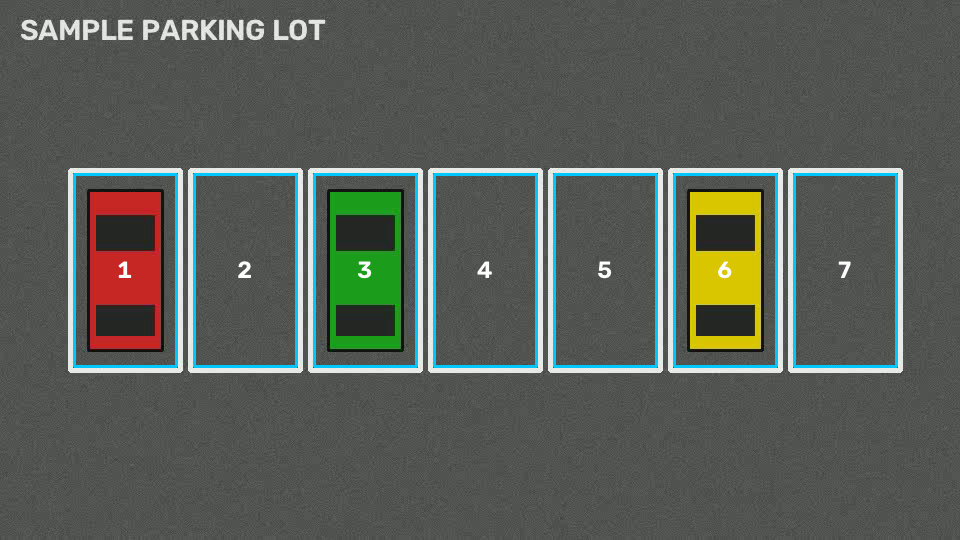

# Smart Parking Occupancy Detection

Digital Image Processing course project.
A fixed camera watches a car park. Classical image processing (no deep learning, no extra sensors) decides for each parking bay whether it is **FREE** or **FULL**, in real time. The target is a Raspberry Pi.

**Tech:** Python · OpenCV · NumPy

## Pipeline (final goal)

1. **Video stream & ROI**: the 4 corners of each parking bay are defined once (`cv2.polylines`)
2. **Pre-processing**: BGR → grayscale, Gaussian blur to reduce noise
3. **Edge / texture analysis**: adaptive threshold, so car details become white pixels
4. **Decision**: white pixels > threshold → FULL, otherwise FREE (`cv2.countNonZero`)

## Roadmap

| Week | Topic | Status |
|------|-------|--------|
| 1 | Project setup, video input, ROI selection & drawing | ✅ Done |
| 2 | Pre-processing (grayscale, blur, adaptive threshold) | ⏳ |
| 3 | Occupancy decision + FREE/FULL overlay + counter | ⏳ |
| 4 | Accuracy evaluation, smoothing, FPS measurement | ⏳ |
| 5 | Dynamic thresholding for changing light | ⏳ |
| 6 | Live web dashboard (Flask) + final report | ⏳ |

## Project structure

```
smart-parking-detection/
├── main.py                  # plays the video and draws the spots
├── select_spots.py          # mark parking bays with the mouse
├── scripts/
│   └── make_sample_video.py # creates a synthetic test video
├── src/
│   ├── config.py            # paths, colours, constants
│   ├── video_source.py      # open a video file / camera, read frames
│   └── spots.py             # save/load/draw/crop parking spots
├── data/
│   └── parking_spots.json   # saved spot coordinates
└── docs/
    └── week1_notes.md       # weekly learning notes (Turkish)
```

## Setup

```bash
python -m venv venv
# Windows: venv\Scripts\activate
# macOS / Linux: source venv/bin/activate
pip install -r requirements.txt
```

## Usage

```bash
# 1. Create a test video (or put your own video in data/)
python scripts/make_sample_video.py

# 2. Mark the parking spots (skip this for the sample video; its spots are already created)
python select_spots.py --source data/sample_parking.mp4

# 3. Play the video with the spots drawn
python main.py --loop

# Save one frame as an image (useful for reports)
python main.py --snapshot outputs/week1.png
```

**Spot selector keys:** left click = add corner (4 per spot) · `u` undo corner · `d` delete last spot · `s` save · `q` quit
**Viewer keys:** `p` pause · `q` quit

## Week 1 result


